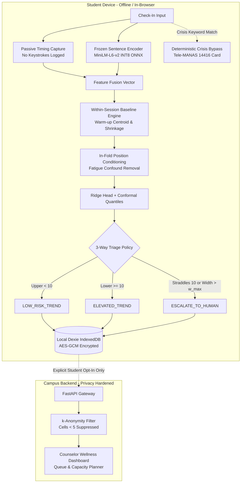

# ANJANEY

> **Personal-Baseline, Abstention-Aware, Text-First Mental-Health Triage for Campus Settings**

[](https://github.com/ANJANEY/anjaney/actions)
[](https://www.python.org/downloads/)
[](LICENSE)
[](docs/PRIVACY_DPDP.md)

ANJANEY is a B.Tech final-year research prototype designed to support university counseling cells with calibrated, privacy-first mental health triage. It addresses three known failure modes in text-based depression screening: conversational shortcut learning, population-level baseline confounding, and overconfident point predictions near diagnostic cutoffs.

> ⚠️ **CLINICAL DISCLAIMER**: ANJANEY is a **screening aid and triage prioritization tool**, never a diagnostic instrument. It outputs uncertainty intervals and risk trends, not clinical diagnoses. Deterministic crisis safeguards operate completely outside the ML model.

---

## 1. System Architecture



---

## 2. Core Research Hypotheses

- **RQ1 (Gating)**: Does within-session drift differ between elevated and low-risk participants after conditioning on interview/turn position, or is it generic task fatigue?
- **RQ2**: Does text + content-free timing multimodal fusion improve selective calibration over text-only features?
- **RQ3**: Does adding personal-baseline deviation reduce conformal interval width and counselor escalation load compared to population-only references?

---

## 3. Quick Start

### Prerequisites

- Python 3.11+
- Node.js 20+ and npm / pnpm
- Docker & Docker Compose (for containerized deployment)

### Local Environment Setup

```bash
# 1. Clone repository
git clone [https://github.com/ANJANEY/anjaney.git](https://github.com/ANJANEY/anjaney.git)
cd anjaney

# 2. Install Python package and development dependencies
pip install -e ".[dev,ml,api]"

# 3. Setup web dependencies
cd apps/web && npm install && cd ../..
```

### Full Pipeline Reproduction (End-to-End)

Run the deterministic research pipeline using synthetic data fixtures:

```bash
# Step 1: Generate synthetic cohort (50 participants, DAIC-WOZ schema)
anjaney data generate-synthetic --n-participants 50 --output-dir data/synthetic

# Step 2: Segment into 5-turn check-in windows & leak-proof StratifiedGroupKFold splits
anjaney data build --source synthetic --output-dir data/processed --window-size 5

# Step 3: Extract MiniLM embeddings, conversational timing dynamics, and lexical metrics
anjaney features build --windows-file data/processed/windows.parquet --output-file data/processed/features.parquet --groups text_embed,timing,lexical

# Step 4: Evaluate population-only reference models & run permutation leakage audit
anjaney train baseline --features-file data/processed/features.parquet --splits-file data/processed/splits.json

# Step 5: Execute pre-registered RQ1 gating analysis
anjaney rq1 run --features-file data/processed/features.parquet --prereg-file configs/prereg.yaml

# Step 6: Calibrate split-conformal prediction intervals (alpha = 0.10)
anjaney conformal run --features-file data/processed/features.parquet --splits-file data/processed/splits.json --alpha 0.10

# Step 7: Run paired ablation grid & generate dynamic RESULTS.md
anjaney eval run --features-file data/processed/features.parquet --splits-file data/processed/splits.json

# Step 8: Export INT8 ONNX bundle and run simulated on-device benchmark
anjaney export bundle --features-file data/processed/features.parquet --output-dir data/processed/bundle
anjaney export benchmark --output-dir docs
```

### Running Tests

```bash
# Run all Python core & API unit tests
pytest

# Run TypeScript on-device parity test
cd apps/web && npm test && cd ../..
```

### Running the Application

**Option A: Local Development**

```bash
# Terminal 1 - Backend API:
uvicorn api.main:app --app-dir apps/api/src --reload --port 8000

# Terminal 2 - Frontend PWA:
cd apps/web && npm run dev
```

**Option B: Docker Compose**

```bash
docker compose up --build
```

- **Student PWA Interface**: [http://localhost:3000](http://localhost:3000)
- **Counselor API & Docs**: [http://localhost:8000/docs](http://localhost:8000/docs)

---

## 4. Repository Structure

```plaintext
anjaney/
├── configs/              # Pydantic-validated settings (default.yaml, prereg.yaml)
├── data/
│   ├── synthetic/        # Committed synthetic test cohort (EULA-safe)
│   ├── processed/        # Windows, features, and model bundle (gitignored)
│   └── raw/              # Protected clinical transcripts (gitignored)
├── src/anjaney/          # Core research library
│   ├── baseline/         # Personal baseline deviation & position conditioning
│   ├── conformal/        # Split-conformal, CQR, normalized intervals, triage policy
│   ├── data/             # Schemas, DAIC-WOZ loader, synthetic cohort generator
│   ├── eval/             # Paired ablation grid, test lock, robustness testing
│   ├── explain/          # Grouped linear contributions & non-diagnostic renderers
│   ├── export/           # INT8 ONNX compilation & bundle serialization
│   ├── features/         # Sentence embeddings cache, timing dynamics, lexical
│   ├── models/           # In-fold participant aggregation & regularized heads
│   ├── preprocess/       # Sliding turn windows & StratifiedGroupKFold partitions
│   ├── safety/           # Deterministic crisis guard (Tele-MANAS override)
│   ├── utils/            # Seed locking, RunContext, git hashing
│   └── cli.py            # Unified Typer CLI (`anjaney`)
├── apps/
│   ├── api/              # FastAPI service (k-anonymity, consent gating, erasure)
│   └── web/              # Next.js PWA (WebWorker on-device inference, Dexie AES-GCM)
├── tests/                # Core test suites and parity fixtures
├── experiments/          # Run artifacts, decision.json, and publication plots
└── docs/                 # Model card, threat model, DPDP matrix, and demo script
```

---

## 5. Privacy & DPDP Act 2023 Compliance

- **Zero Free-Text on Server**: The backend schema contains no free-text columns. Check-in transcripts are scored completely inside the student's browser and discarded immediately.
- **Encrypted at Rest**: Local state (centroid embeddings and rolling deviations) is encrypted in IndexedDB using non-extractable WebCrypto AES-GCM keys.
- **k-Anonymity Dashboard**: Aggregates with fewer than 5 students ($k < 5$) are strictly redacted from wellness cell dashboards.
- **Right to Erasure**: `DELETE /api/v1/me/{pseudonymous_id}` permanently purges consent records, aggregates, and escalations.
- **Deterministic Crisis Safeguard**: Mentions of self-harm bypass all inference pipelines to immediately present Tele-MANAS (14416) emergency contact information.